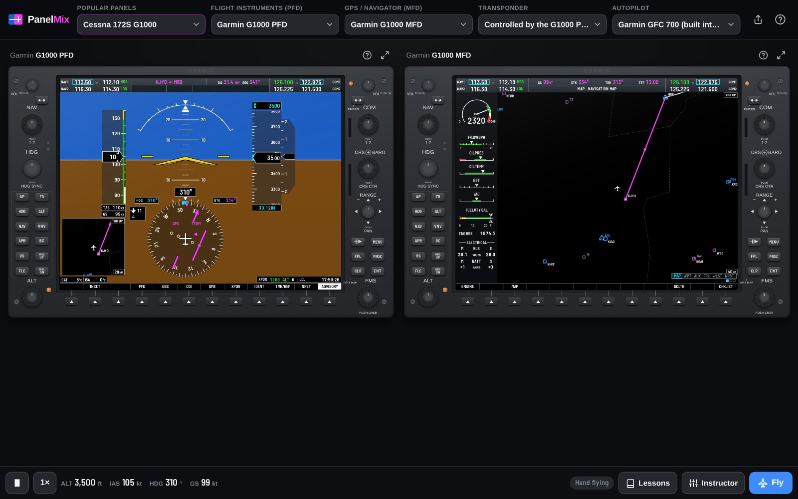
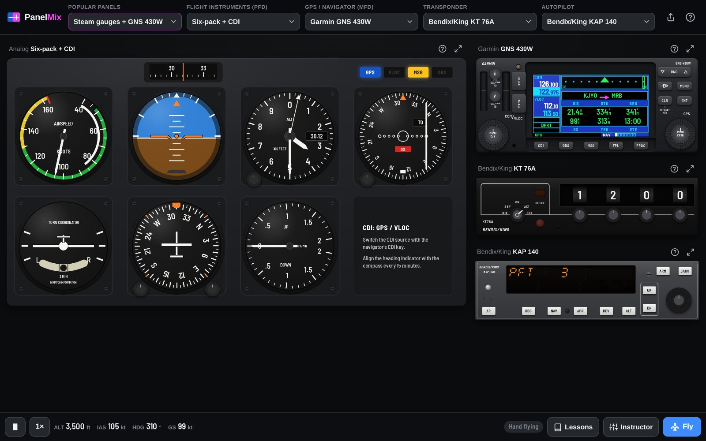
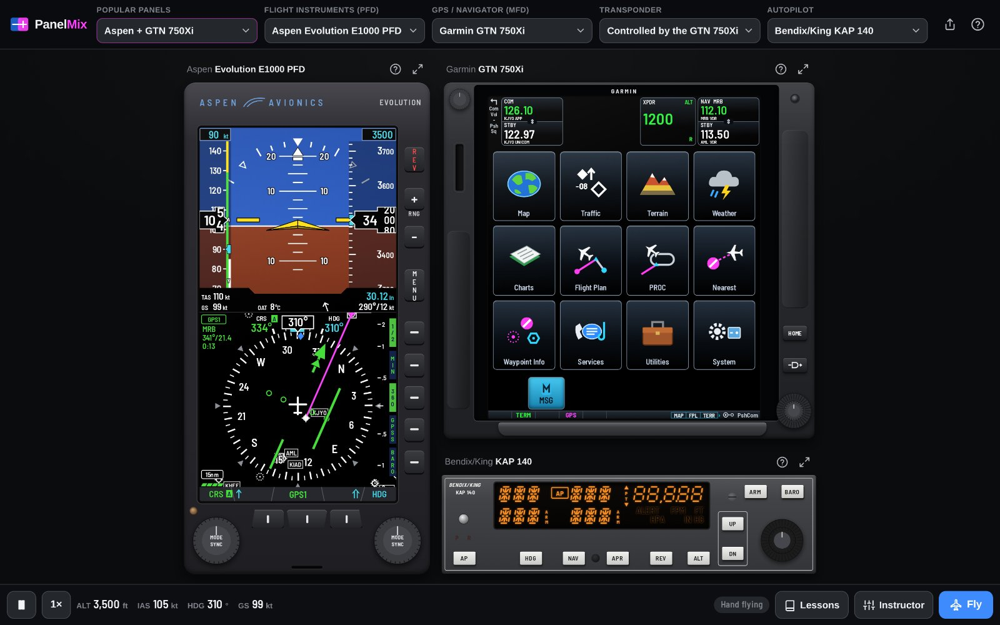
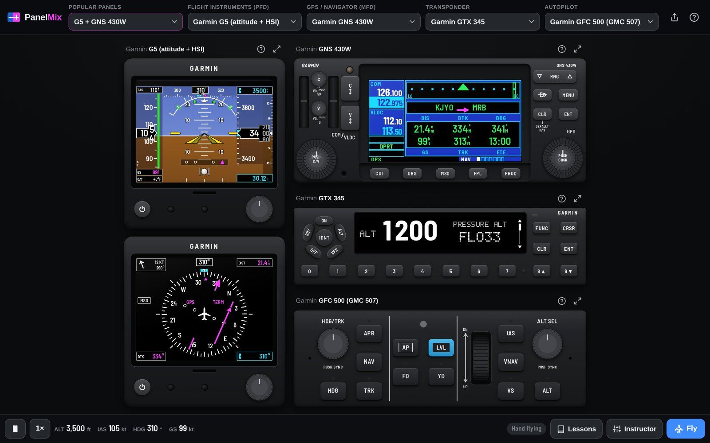
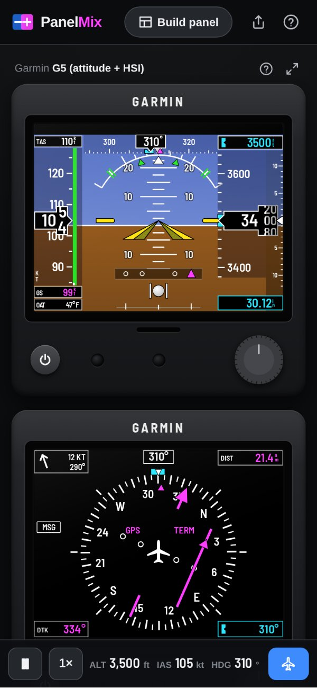

# PanelMix

A browser avionics trainer for mixed panels. Pick the flight instruments, the GPS navigator, the
transponder and the autopilot from dropdowns, the way real training airplanes are equipped, and
practise every key and knob. The units share one simulator, so they talk to each other like the
real ones: a flight plan built on the navigator drives the PFD's course needle, the CDI key picks
GPS or VOR, an autopilot flies the heading bug you set on the HSI.

Try it: https://kihsomray.github.io/panelmix/



| Steam gauges + GNS 430W + KT 76A + KAP 140 | Aspen E1000 + GTN 750Xi + KAP 140 |
|---|---|
|  |  |

| G5 + GNS 430W + GTX 345 + GFC 500 | On a phone |
|---|---|
|  |  |

## Units

| Slot | Units |
|---|---|
| Flight instruments | Six-pack with a GPS/VLOC CDI, Garmin G5 (attitude + HSI), Aspen Evolution E1000, Garmin G1000 PFD |
| Navigator | Garmin GNS 430W, GNS 530W, GTN 650Xi, GTN 750Xi, G1000 MFD |
| Transponder | Garmin GTX 345, Bendix/King KT 76A, or the GTN / G1000 controlling one |
| Autopilot | Bendix/King KAP 140, Garmin GFC 500 (GMC 507), the G1000's GFC 700, or a basic sim autopilot |

Presets cover the common real installations (172S G1000, G5 + GNS 430W, Aspen + GTN 750Xi, steam
gauges + 430W...). A panel can be shared as a link.

What works, in short: tuning and flip-flopping radios, direct-to with knob or keypad entry and
spell-ahead, building and editing flight plans, nearest airports and VORs with frequency loading,
airport and VOR information pages, maps with range and declutter, CDI source and OBS, bearing
pointers, transponder codes, modes and ident, and autopilot modes (heading, NAV arm and capture,
altitude preselect and capture, VS, FLC, level, GPS steering) flown by a small energy-based flight model.

The database has about 5,000 US public-use airports with runways and frequencies and 2,700 VORs and
NDBs, plus fixes, airways, localizers and instrument procedures from the FAA CIFP, Class B/C/D
airspace and terrain.

## Running it

```sh
npm install
npm run dev        # http://localhost:5173
npm run check      # typecheck, tests, production build
npm run navdata    # rebuild public/data from the sources below
```

## How it is built

- `src/core`: geodesy, radio channel arithmetic, the navigation database, magnetic variation.
- `src/sim`: the shared simulator. State, commands (every change goes through one), flight model,
  flight management (plan, direct-to, OBS, sequencing), VOR receivers, the CDI/HSI picture and the
  autopilot guidance laws.
- `src/ui`: the device kit. Scaled device frames, knobs (drag, wheel, keyboard and a touch dock),
  bezel buttons, screens, glass instruments and the moving map.
- `src/devices`: one folder per unit family, each self-contained. See
  [docs/DEVICE_GUIDE.md](docs/DEVICE_GUIDE.md) to add one.
- `src/shell`: the panel picker, layout, flight controls and help.

Preact, TypeScript (strict), Vite, Vitest; no other runtime dependencies. Works offline after the
first visit.

## Data

Airports, runways, frequencies and navaids from [OurAirports](https://ourairports.com/data/), coastlines
and borders from [Natural Earth](https://www.naturalearthdata.com/), magnetic variation from the NOAA
World Magnetic Model 2025. All public domain.

## Disclaimer

A training aid for learning buttonology, not for navigation or flight. Not affiliated with or endorsed
by Garmin, Aspen Avionics or Bendix/King; product names only identify the units being imitated.
